<div align="center">

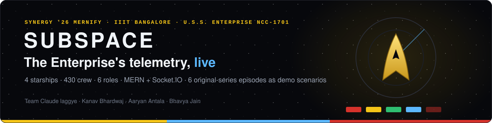

# Subspace

**Space: the final frontier, and every reading on it arrives in real time.**

A real-time telemetry bridge for the USS Enterprise (NCC-1701), from *Star Trek: The Original Series* (1966). A simulator streams ship telemetry, a MERN + Socket.IO backend validates, stores and fans it out by role, and six roles watch it on a bridge where every station is a live dashboard.

[](https://github.com/Paradox-73/NCC-1701/actions/workflows/ci.yml)
[](https://github.com/Paradox-73/NCC-1701/actions/workflows/deploy.yml)
[](https://ncc-1701.vercel.app)


[Live demo](https://subspace-1701.vercel.app) (also [ncc-1701.vercel.app](https://ncc-1701.vercel.app)) | [Demo video](https://drive.google.com/drive/folders/1VZM54i9kOGE2rhGFl7RCe29OpnfluzHg?usp=sharing) | [Docs](docs/) | [Repository](https://github.com/Paradox-73/NCC-1701)

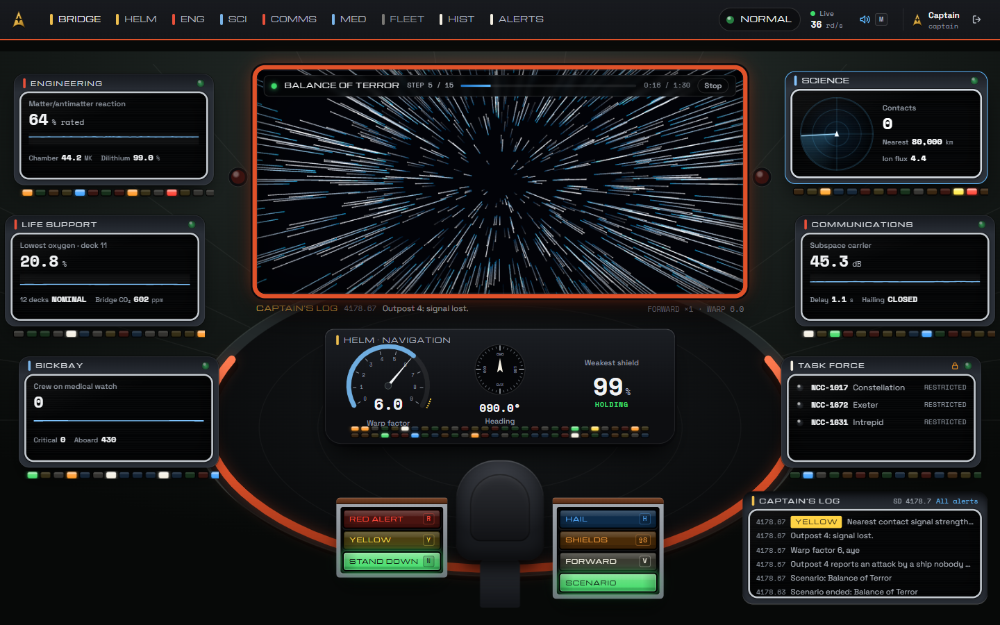

</div>

> *Stardate: 13 to 15 November 2026 (Earth calendar), the MERNify build window.* Built for the MERNify hackathon, track "High-Throughput Streams & Telemetry".

## Contents

1. [Project overview and problem addressed (Captain's briefing)](#project-overview-and-problem-addressed-captains-briefing)
2. [Features implemented (Bridge stations)](#features-implemented-bridge-stations)
3. [Tech stack](#tech-stack)
4. [Setup and execution (Engineering)](#setup-and-execution-engineering)
5. [Data generation and ingestion (Starfleet sensors)](#data-generation-and-ingestion-starfleet-sensors)
6. [Real-time communication (Subspace channels)](#real-time-communication-subspace-channels)
7. [Architecture diagrams](#architecture-diagrams)
8. [How to run and test (Diagnostics)](#how-to-run-and-test-diagnostics)
9. [Performance and stress-test results (Warp trials)](#performance-and-stress-test-results-warp-trials)
10. [Bonus items (Commendations)](#bonus-items-commendations)
11. [Demo guide (Captain's log)](#demo-guide-captains-log)
12. [Project structure and where our code is](#project-structure-and-where-our-code-is)
13. [Deployment](#deployment)
14. [External libraries, APIs and assets (Credits)](#external-libraries-apis-and-assets-credits)
15. [Team (The crew)](#team-the-crew)

## Project overview and problem addressed (Captain's briefing)

Telemetry dashboards tend to be one of two things: a demo with fake numbers, or a real pipeline with a plain grid of charts. The MERNify problem statement asks for a platform that ingests continuous streams from many sources, keeps system state, stores records for history, broadcasts relevant updates to many clients, and stays responsive under frequent updates. Subspace does that for a starship.

- **The pipeline.** Several sources send thousands of readings a second over links that can duplicate, reorder and corrupt data. The server validates each sample, drops duplicates and stale data, rate-limits floods, checks for anomalies, stores samples as a MongoDB time series and sends each viewer only the data its role may see.
- **The screen.** The captain, the chief engineer and the doctor need different views of one ship. The UI is a recreation of the original-series bridge with seven stations, History and Alerts pages, and a 3D viewscreen.
- **The domain.** One ship has 121 channels (warp core, shields, hull, twelve decks of life support, sensors, transporter, comms) and 430 crew. Four ships and four sickbay hubs make eight sources.

**Two units used throughout.** A *sample* is one reading of a whole source at one instant: a ship's 121 channels, or a sickbay hub's 1,720 crew values. A *channel value* is one number inside a sample. With the full local simulator the server receives about 115 samples a second, about 20,000 channel values a second (`docs/PERFORMANCE.md`, `loadtest/README.md`).

## Features implemented (Bridge stations)

- **Live bridge and seven stations.** Helm, Engineering, Science, Communications, Sickbay, Starfleet Command, plus History and Alerts pages. Monitors show live values with sparklines and gauges, a sector map, a 430-crew biosign grid and a 3D viewscreen (react-three-fiber) with a 2D fallback.
- **Role-based access, enforced on the server.** Six roles. Each joins only the Socket.IO rooms and reads only the history its role allows. The engineer never receives crew medical data and the doctor never receives the warp core. The REST history endpoint applies the same rule (403).
- **Red alert: anomaly detection.** Threshold rules, a rolling z-score (|z| > 4 held for 0.5 s after a 30 s warm-up) and link loss. A critical alert in hull, shields, life support, warp or crew raises the ship to yellow alert. Alerts can be acknowledged by role.
- **Commands back to the ship.** Warp, shields, phasers, torpedoes, hail, power presets, transporter, quarantine, inoculate, cold restart. Each is validated with zod, checked against the role, rate-limited, sent to the simulator over its ingest socket and acknowledged in the captain's log.
- **History merged with live data.** Charts load stored data and keep streaming, joined by sequence number, with no gap and no duplicate, including after a reconnect.
- **Six playable episodes.** Scripted incidents that run through the real pipeline (see the [demo guide](#demo-guide-captains-log)).
- **Sound.** Klaxons, phasers, hailing and a heartbeat at the selected crew member's live heart rate, on the Web Audio API. Off by default (`M` toggles).

| | |
|---|---|
| 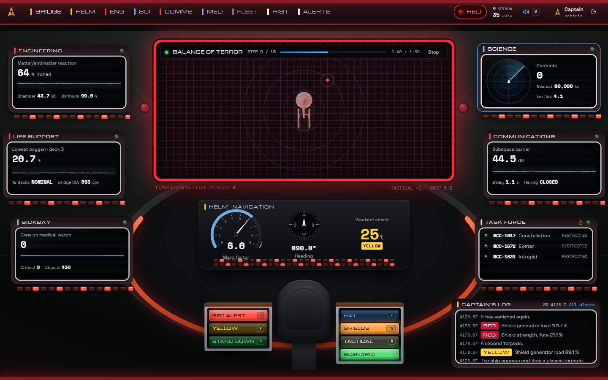 | 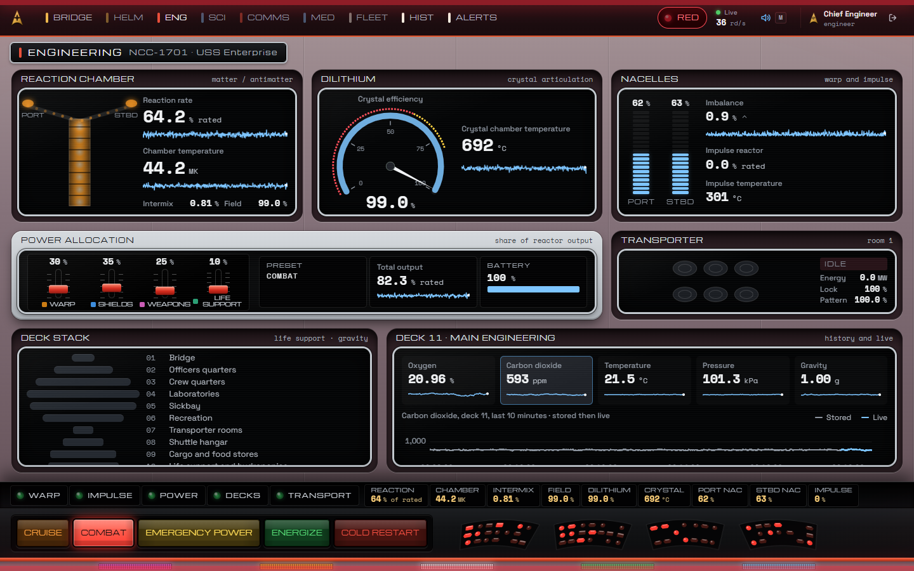 |
| **Red alert.** A plasma torpedo takes the weakest shield to 25 % and the alerts reach the log. | **Engineering.** Monitors are live channels and the desk buttons are real commands. |
| 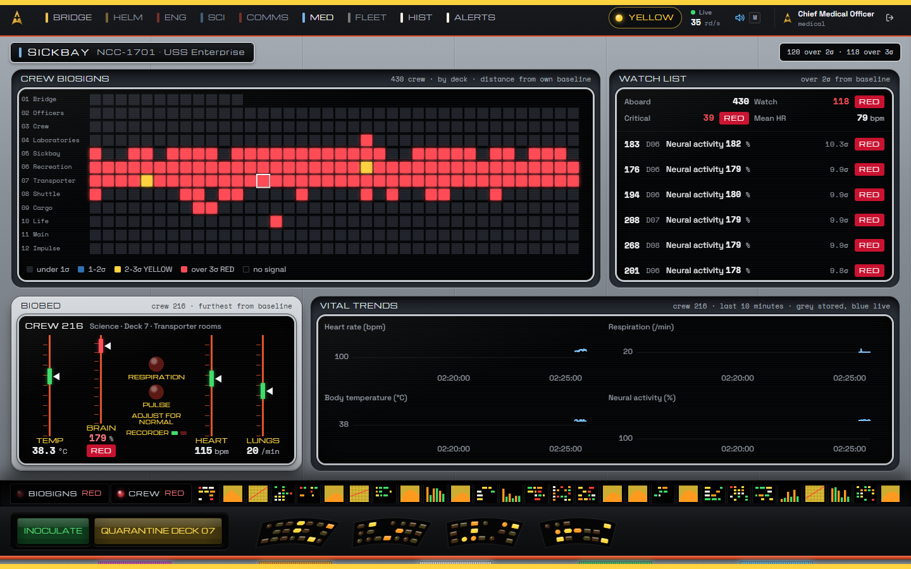 | 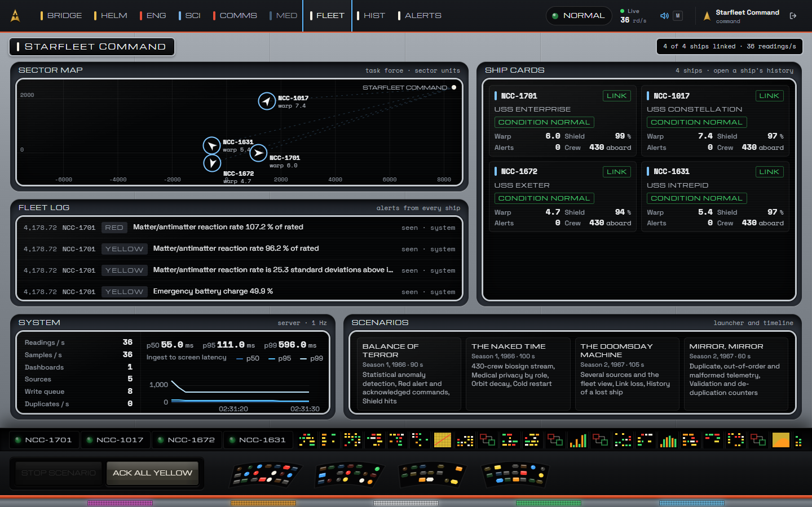 |
| **Sickbay.** Each crew member is measured against their own baseline. | **Starfleet Command.** The task force on a sector map, fleet alerts, server latency, the scenario launcher. |
| 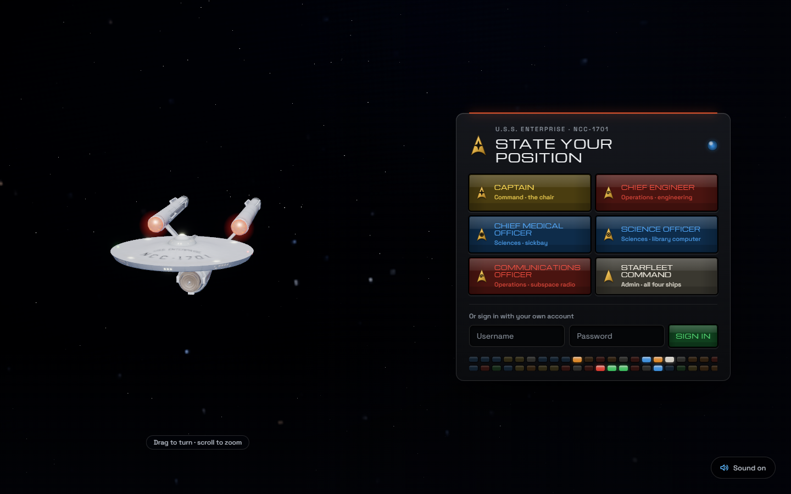 | 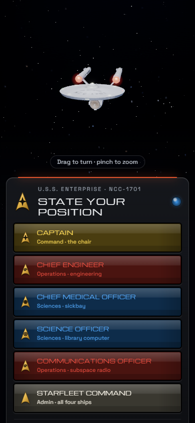 |
| **Login.** State your position; the ship turns on the left. | **Phone.** The console stacks into one column. |

## Tech stack

| Layer | Technology |
|---|---|
| Database | MongoDB 8 with Mongoose: time-series collection for telemetry, TTL retention for telemetry and alerts |
| Server | Node.js, Express 5, Socket.IO 4 with the MessagePack parser (`socket.io-msgpack-parser`), zod validation, JWT with bcrypt, `express-rate-limit` |
| Client | React 19, Vite 6, React Router 7, uPlot (charts), three.js with react-three-fiber and drei (3D), canvas, Web Audio |
| Simulator | Node.js ship physics and crew vitals, speaking the same wire format as any real device |
| Tests | `node --test` (Node's built-in runner) across `shared`, `server` and `client` |
| Ops | Docker Compose locally; Render (server with embedded simulator), Vercel (client), MongoDB Atlas; GitHub Actions for CI and deploy |

Exact versions are in the `package.json` files of [`server`](server/package.json), [`client`](client/package.json), [`simulator`](simulator/package.json) and [`loadtest`](loadtest/package.json).

## Setup and execution (Engineering)

### Docker, one command

Needs Docker with Compose and free ports 5173 (app) and 4000 (server).

```bash
docker compose up --build
```

This starts four containers: MongoDB, the server, the client (nginx) and the simulator. Open <http://localhost:5173>, press **Engage**, and sign in with one of the [demo logins](#demo-logins).

### Manual

Needs Node.js 24 and a MongoDB 8 instance on `127.0.0.1:27017`.

```bash
npm install
docker run -d --rm --name ncc-mongo -p 127.0.0.1:27017:27017 mongo:8   # or any local mongod
npm run dev -w server        # API and sockets, http://localhost:4000
npm start -w simulator       # four ships and four sickbay hubs
npm run dev -w client        # http://localhost:5173
```

To skip the separate simulator, run it inside the server process: `SIM_EMBED=1 npm run dev -w server`.

Configuration is in [`.env.example`](.env.example). With `NODE_ENV=production` the server refuses the example secrets.

## Data generation and ingestion (Starfleet sensors)

There is no hardware, so [`simulator/`](simulator) plays the ships and talks to the server as a real device would.

- **4 ships** (Enterprise, Constellation, Exeter, Intrepid), each with a physics model: matter/antimatter reaction, dilithium wear, nacelle balance, power allocation, shields that take hits and recharge, hull stress, oxygen and CO2 on twelve decks, sensor contacts, transporter cycles and subspace comms ([`simulator/src/physics.js`](simulator/src/physics.js)). 121 channels per sample, 50 Hz for the Enterprise and 20 Hz for the others.
- **4 sickbay hubs**, one per ship, streaming heart rate, respiration, body temperature and neural activity for all 430 crew, each with their own baseline, at 1 Hz ([`simulator/src/crew.js`](simulator/src/crew.js)). That is 1,720 values per sample.
- **Scenarios** steer the simulator through `sim:command` verbs (`hit`, `ramp`, `fault`, `crew`, `mute` and others), so an episode is real telemetry the detector has to catch, not canned alerts.
- **Event format.** Each sample is packed as integers `[seq, ts, v0, v1, ...]`, with the source id on the batch. `seq` and `ts` identify the event and its time, which is what lets the server detect duplicates and out-of-order data. Definition: [`shared/schema.js`](shared/schema.js). The whole domain (sources, channels, ranges, roles, alert rules) is one file: [`shared/registry.js`](shared/registry.js).
- **Sender behaviour.** The simulator batches samples, keeps at most 4 batches un-acknowledged, pauses when the server returns `credit: 0`, and resends after a drop.

## Real-time communication (Subspace channels)

Socket.IO carries every live update, with two namespaces. Full contract: [`docs/PROTOCOL.md`](docs/PROTOCOL.md).

- **`/ingest`**: one authenticated connection per source (source id plus device key). The source sends `telemetry:batch` (MessagePack). The server answers every batch with an ack holding counts (`accepted`, `duplicates`, `stale`, `invalid`, `throttled`) and a `credit` for backpressure.
- **`/live`**: dashboards, authenticated by JWT. Rooms:

  | Room | Carries |
  |---|---|
  | `src:<id>:<group>` | one channel group of one source, for example `src:1:shields`; joined by `subscribe`, only for groups and ships the role may see (others return `denied`) |
  | `ship:<id>` | ship events: condition, captain's log, scenario progress, effects, command acks |
  | `overview:<role>` | a fleet summary at 5 Hz, filtered for the role |
  | `alerts:<group>` | alerts for one channel group |
  | `admin` | server metrics at 1 Hz, for roles that have `admin` |

- **Batching and throttling.** The broadcaster builds one `telemetry:frame` per non-empty room every 50 ms and sends it once to every subscriber, not one message per sample. The overview is sent as volatile, so a slow client drops it instead of queueing it. Payloads carry only the channels of the subscribed group.
- **Client side.** One socket per tab, rooms are reference-counted, frames go into ring buffers outside React state ([`client/src/lib/ring.js`](client/src/lib/ring.js), [`client/src/lib/store.js`](client/src/lib/store.js)), and charts and gauges are drawn on one shared animation-frame loop ([`client/src/lib/raf.js`](client/src/lib/raf.js)), so a 50 Hz stream does not re-render React 50 times a second.
- **History plus live.** The client subscribes first, fetches `GET /api/telemetry`, which also returns samples not yet written, then drops buffered frames with `seq` at or below `lastSeq`. After a reconnect it fetches the gap and merges by `seq`.

## Architecture diagrams

Longer explanations are in [`docs/ARCHITECTURE.md`](docs/ARCHITECTURE.md).

### System architecture

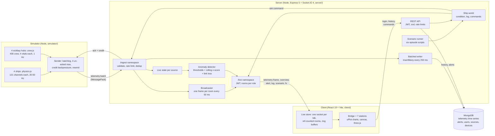

### Data flow: ingestion, processing, storage, broadcast

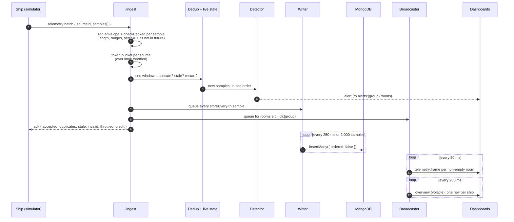

### Database schema and data model

Taken from the Mongoose models in [`server/src/models/index.js`](server/src/models/index.js). The `telemetry` time-series collection is created in [`server/src/db.js`](server/src/db.js).

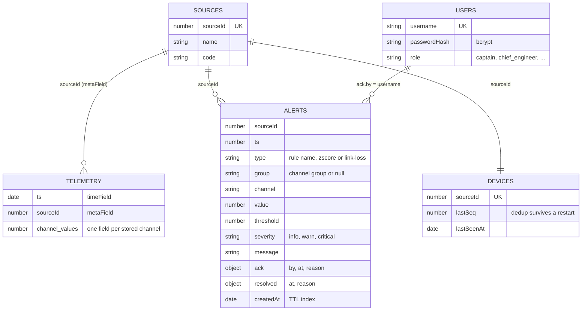

Retention: telemetry expires after `TELEMETRY_TTL_SEC` (24 h locally, 2 h on the hosted free tier), alerts after `ALERTS_TTL_SEC` (7 days locally). Indexes: `alerts` on `{ sourceId, ts }`, unique `sourceId` on `sources` and `devices`, unique `username` on `users`.

### Rooms: who receives what

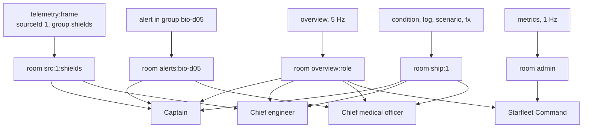

## How to run and test (Diagnostics)

```bash
npm test                     # shared, server and client tests (node --test)
npm run loadtest:smoke       # 15 s load test against a running server
npm run loadtest -- --preset large
```

- **Unit and integration tests.** `npm test` runs [`shared/test`](shared/test), [`server/test`](server/test) (ingest, dedup, detector, history, live rooms, API, alerts, scenarios, TTL, simulator and others) and [`client/test`](client/test) (ring buffer and limits). The server tests need MongoDB on `127.0.0.1:27017`.
- **CI.** [`.github/workflows/ci.yml`](.github/workflows/ci.yml) runs on every pull request and every push to main: `npm test` against a MongoDB 8 service container, a client build as Vercel does it, and a build of `server/Dockerfile`.
- **Load test.** [`loadtest/`](loadtest) starts N sources at H Hz and K dashboard clients and measures acknowledgement time, end-to-end latency and throughput; it can inject duplicates, reordering and malformed samples and run a rogue source. Options: [`loadtest/README.md`](loadtest/README.md).

## Performance and stress-test results (Warp trials)

Run on one Apple M2 laptop (8 cores, 8 GB) with the full simulator in the same process, 14 Nov 2026. Each source sends the `helm` and `warp` channels over `/ingest`. Each dashboard client signs in as Starfleet Command, subscribes to every load-test source and times each sample from its source timestamp to arrival. Setup details and caveats: [`docs/PERFORMANCE.md`](docs/PERFORMANCE.md).

| Run | Sources x rate | Dashboard clients connected | Samples accepted / s | End to end p50 / p95 / p99 | Errors |
|---|---|---|---|---|---|
| smoke (15 s) | 5 x 10 Hz | 5 | 50 | 101 / 159 / 188 ms | 0 |
| medium (60 s) | 40 x 10 Hz | 100 | 399 | 102 / 158 / 176 ms | 0 |
| large (90 s) | 80 x 10 Hz | 250 | 799 | 107 / 169 / 188 ms | 0 |
| stretch (60 s) | 85 x 20 Hz | 600 | 1,696 | 117 / 172 / 186 ms | 0 |
| fault injection (30 s) | 40 x 10 Hz with 5% duplicates, 5% reordered, 2% invalid | 100 | 390 | 106 / 170 / 240 ms | 0 |

- The stretch run delivered 1,051,716 frames to 600 clients in a minute, with a median of 40% of one CPU core.
- In the fault-injection run the server counted exactly the 564 injected duplicates and 257 malformed samples and rejected them before storage and broadcast. All clients stayed connected.
- End-to-end latency sits near 100 ms in the load test because of its own timers (100 ms sample timer, 50 ms batching, 50 ms frames). What matters is that it barely moves with load.
- The ceiling we reached was the source-id limit (`LIMITS.maxSourceId = 99`), not the server.

**Reproduce:**

```bash
SIM_EMBED=1 npm run dev -w server     # MongoDB must be running
npm run loadtest -- --preset medium
npm run loadtest -- --preset large
npm run loadtest -- --sources 85 --hz 20 --clients 600 --seconds 60
npm run loadtest -- --preset medium --seconds 30 --dup 0.05 --reorder 0.05 --invalid 0.02
```

Each run prints a JSON summary and writes it to [`loadtest/results/`](loadtest/results). The raw result behind every row of the table is committed there (all from the Apple M2 laptop; [`docs/PERFORMANCE.md`](docs/PERFORMANCE.md) maps each row to its file), along with a later rerun of smoke and medium on a Windows laptop, whose numbers differ.

## Bonus items (Commendations)

| Bonus item in the problem statement | How it is done | Where |
|---|---|---|
| Anomaly detection and alerts | Threshold rules, rolling z-score (|z| > 4 for 0.5 s) and link loss; alerts stored, sent to `alerts:<group>` rooms, acknowledgeable | [`server/src/anomaly/detector.js`](server/src/anomaly/detector.js), [`server/src/alerts.js`](server/src/alerts.js) |
| Backpressure, rate limiting, protection from excess events | Per-source token bucket; `credit` in every ack so the sender pauses; limits on queue depth; REST and login rate limits; zod validation; device keys | [`server/src/ingest/tokenBucket.js`](server/src/ingest/tokenBucket.js), [`server/src/ingest/namespace.js`](server/src/ingest/namespace.js), [`server/src/middleware/index.js`](server/src/middleware/index.js) |
| Selective broadcasting, small payloads | One frame per room per 50 ms with only that group's channels; packed integer samples in MessagePack; role-filtered overview | [`server/src/live/broadcaster.js`](server/src/live/broadcaster.js), [`shared/schema.js`](shared/schema.js) |
| Client batching, throttling, windowing | Frames into ring buffers, one shared animation-frame draw loop, virtualised lists | [`client/src/lib/ring.js`](client/src/lib/ring.js), [`client/src/lib/raf.js`](client/src/lib/raf.js), [`client/src/components/VirtualList.jsx`](client/src/components/VirtualList.jsx) |
| Independent subscriptions per client | `subscribe` joins only the groups requested and allowed; rooms are reference-counted per tab | [`server/src/live/namespace.js`](server/src/live/namespace.js), [`client/src/lib/store.js`](client/src/lib/store.js) |
| History alongside live telemetry | Time-series history merged with the live stream by `seq`; `$bucketAuto` downsampling; unflushed samples included | [`server/src/routes/telemetry.js`](server/src/routes/telemetry.js), [`client/src/stations/parts/history.js`](client/src/stations/parts/history.js) |
| Duplicate and out-of-order handling | Per-source sequence window (bitset) detects duplicates, stale samples and restarts | [`server/src/ingest/dedup.js`](server/src/ingest/dedup.js) |
| Performance and stress-test results | Load test with events and client counts, results committed | [`loadtest/`](loadtest), [`docs/PERFORMANCE.md`](docs/PERFORMANCE.md) |
| Hosting | Client on Vercel, server on Render, database on MongoDB Atlas | [`render.yaml`](render.yaml), [`vercel.json`](vercel.json), [`docs/DEPLOY.md`](docs/DEPLOY.md) |
| Design and architecture document | Diagrams above and in the docs | [`docs/ARCHITECTURE.md`](docs/ARCHITECTURE.md) |

## Demo guide (Captain's log)

*Captain's log, stardate 15 November 2026. The ship is live at <https://ncc-1701.vercel.app>. The hosted server runs on a free Render instance and may take a minute to wake.*

### Demo logins

| Username | Password | Role | Sees |
|---|---|---|---|
| `captain` | `ncc-captain` | Captain | everything on the Enterprise and every command; the Starfleet station is locked |
| `engineer` | `ncc-engineer` | Chief Engineer | warp, power, shields, hull, decks, transporter |
| `medical` | `ncc-medical` | Chief Medical Officer | 430 crew biosigns and life support |
| `science` | `ncc-science` | Science Officer | sensors, helm, shields, hull |
| `comms` | `ncc-comms` | Communications Officer | comms, helm, sensors |
| `command` | `ncc-command` | Starfleet Command (admin) | the whole task force, Starfleet station, scenarios, server metrics |

Open two browsers with different roles to see each client receive only its own data.

### The six episodes

Start one from the **SCENARIO** button on the bridge (captain or command), or from the scenarios panel on the **FLEET** station (command). Only one runs at a time. Definitions are in [`shared/scenarios/`](shared/scenarios).

| Episode | What it exercises |
|---|---|
| *Balance of Terror* | A cloaked ship that only the statistics see: anomaly detection and red alert. |
| *The Naked Time* | The 430-crew stream, medical privacy and a cold restart of the engines. |
| *The Doomsday Machine* | Link loss, and the history of a ship that went silent. |
| *Mirror, Mirror* | An ion storm: duplicated, reordered and malformed data, kept out of the charts. |
| *The Trouble with Tribbles* | Per-deck carbon dioxide rising, and a forecast. |
| *Space Seed* | Forged data, a flood and a hijacked ship, refused by validation, rate limits and device keys. |

### Keyboard shortcuts

Press `?` for the full sheet. The main ones:

| Keys | Action |
|---|---|
| `0` to `9`, up/down | Warp factor (captain) |
| `I`, `X` | Full impulse, all stop (captain) |
| left/right | Heading 5 degrees (captain) |
| `Shift S`, `P`, `Shift P` | Shields, phasers, photon torpedo (captain) |
| `R`, `Y`, `N` | Red alert, yellow alert, stand down (captain) |
| `H` | Hailing frequencies (captain, comms) |
| `V`, `+`, `-` | Viewscreen mode and magnification |
| `G` then `B H E S C M F` | Go to Bridge, Helm, Engineering, Science, Comms, Sickbay, Starfleet |
| `Ctrl K` | Turbolift: pick any station, including History and Alerts |
| `A` | Acknowledge the newest alert |
| `M` | Sound on or off (off by default) |

### Guided tour and help

The first time a role opens a page, a spotlight tour explains the monitors on it ([`client/src/app/tours.js`](client/src/app/tours.js)); it is remembered per user in the browser, so clearing site data replays it. `?` opens the shortcut sheet at any time. Suggested walk-through: sign in as `captain`, press **Engage**, run *Balance of Terror*, press `V` for the tactical view, then open `/history` and pick a channel to see stored and live data joined.

## Project structure and where our code is

```text
.
|-- client/       React 19 + Vite app: bridge, stations, 3D viewscreen, live store
|-- server/       Express 5 + Socket.IO: ingest, detector, writer, broadcaster, REST, ship world
|-- simulator/    Ship physics and crew vitals, sent over /ingest
|-- shared/       Registry (the domain), wire format, scenario scripts
|-- loadtest/     Load and fault-injection tool and committed results
|-- docs/         ARCHITECTURE, PROTOCOL, DOMAIN, DESIGN, PERFORMANCE, DEPLOY, RESEARCH, screenshots
|-- .github/      Workflows: ci.yml, deploy.yml, keepalive.yml
|-- docker-compose.yml, render.yaml, vercel.json, .env.example
`-- CREDITS.md
```

| Concern | Where |
|---|---|
| Domain: ships, channels, roles, alert rules | [`shared/registry.js`](shared/registry.js) |
| Wire format and limits | [`shared/schema.js`](shared/schema.js) |
| Episode scripts | [`shared/scenarios/`](shared/scenarios) |
| Ingest, validation, dedup, rate limit, writer | [`server/src/ingest/`](server/src/ingest) |
| Anomaly detector and alerts | [`server/src/anomaly/`](server/src/anomaly), [`server/src/alerts.js`](server/src/alerts.js) |
| Rooms and broadcasting | [`server/src/live/`](server/src/live) |
| REST API (auth, history, alerts, ships) | [`server/src/routes/`](server/src/routes) |
| Ship world, commands, scenario runner | [`server/src/ships/`](server/src/ships) |
| Data models | [`server/src/models/index.js`](server/src/models/index.js) |
| Simulator | [`simulator/src/`](simulator/src) |
| Stations and pages | [`client/src/stations/`](client/src/stations), [`client/src/pages/`](client/src/pages) |
| Live store, ring buffers | [`client/src/lib/`](client/src/lib) |
| 3D ship and viewscreen | [`client/src/three/`](client/src/three) |

Originality note: the real-time engine (ingest validation, de-duplication, rate limits, batched time-series writer, history merged with live data, rooms, detector, load test, client live store, chart and virtual list) is adapted from PitWall, a race-car telemetry project our team wrote earlier in this hackathon's window, with the race-specific parts removed and the wire format made data-driven. The domain, simulator physics and crew model, ship world on the server, scenarios and the whole bridge client were written for this project.

## Deployment

Client on Vercel, server and embedded simulator on Render, database on MongoDB Atlas. Pushing to `main` runs CI and the deploy workflow ([`deploy.yml`](.github/workflows/deploy.yml), which calls the Render deploy hook and deploys the client to Vercel), and the hosts also deploy `main` from their GitHub integrations. Pull requests get a Vercel preview. A keep-alive workflow pings `/api/health` so the free server does not sleep. Step-by-step setup, environment variables and rollback: [`docs/DEPLOY.md`](docs/DEPLOY.md).

- Client: <https://ncc-1701.vercel.app>
- Server: <https://ncc-1701.onrender.com> (health check at `/api/health`)

## External libraries, APIs and assets (Credits)

Full list with sources and licences: [`CREDITS.md`](CREDITS.md). Summary:

- **Libraries:** MongoDB and Mongoose, Express, Socket.IO and `socket.io-msgpack-parser`, zod, jsonwebtoken and bcrypt, `express-rate-limit`, React, Vite, React Router, uPlot, three.js, react-three-fiber and drei. Exact packages and versions are in the `package.json` files. No external APIs are called.
- **3D model:** "Classic U.S.S. Enterprise from Star Trek TOS" by Major Stress on Sketchfab, CC BY 4.0, converted and compressed by us.
- **Fonts:** Michroma, Space Grotesk and Space Mono, SIL Open Font License 1.1, via `@fontsource`.
- **Audio:** the opening narration and theme and the sound effects (via TrekCore) are original-series audio owned by CBS/Paramount, used non-commercially. They are optional: remove `client/public/audio/` and `client/public/sfx/` and the app falls back to synthesized sounds.

## Team (The crew)

- Kanav Bhardwaj
- Aaryan Antala
- Bhavya Jain

## Disclaimer

*Star Trek* and all related marks, names, ships, sounds and images belong to CBS Studios and Paramount. This is a non-commercial fan project made for a college hackathon, not affiliated with or endorsed by them. *Live long and prosper.*
