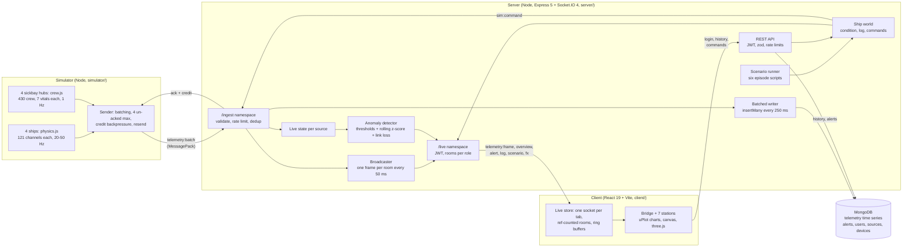
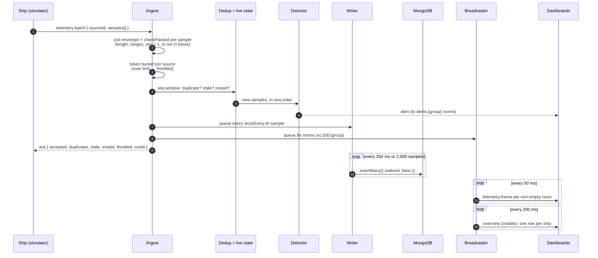
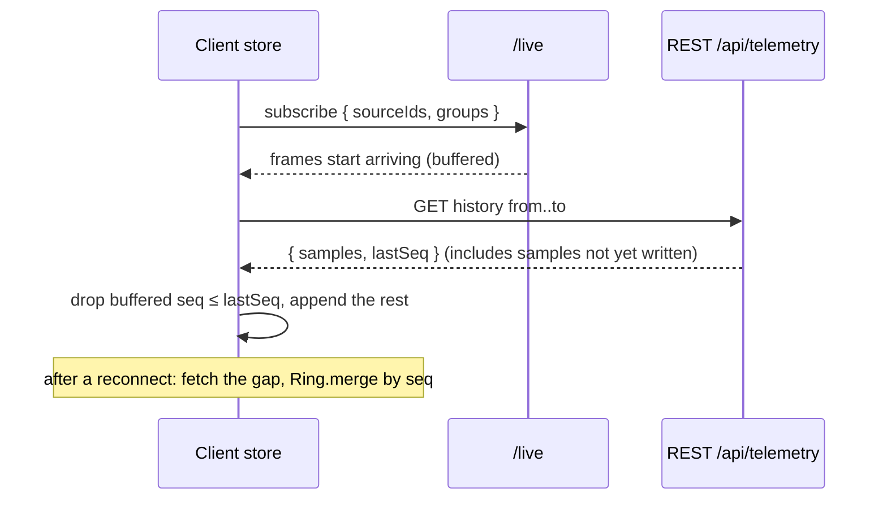
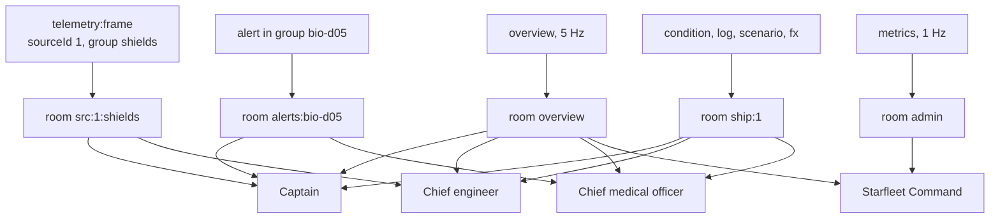
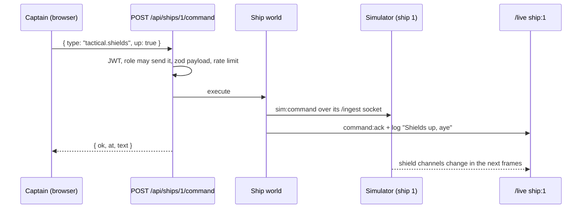
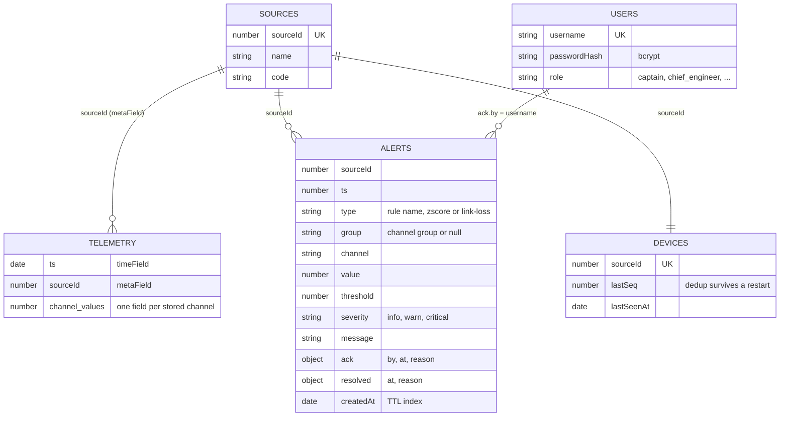
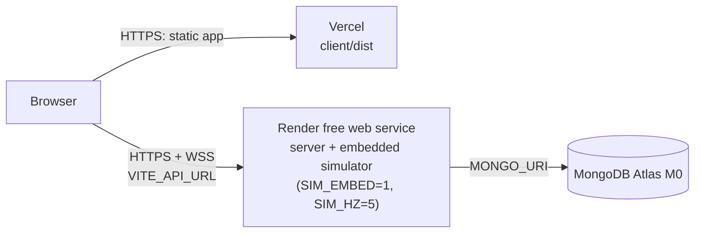

# Architecture

How a reading gets from a simulated starship to the bridge screen: the system parts, the path one sample takes, the rooms that fan it out, how commands go back to the ship, and what MongoDB stores. The wire contract is in `PROTOCOL.md` and the domain (ships, channels, roles, alert rules) is in `DOMAIN.md`. This file shows how they fit together.

## System

| Part | Where | Job |
|---|---|---|
| Registry | `shared/registry.js` | The whole domain in one file: 8 sources, channel lists, groups, roles, alert rules, stardate. Nothing else names a channel. |
| Wire format | `shared/schema.js` | Packs a sample as integers `[seq, ts, v0, v1, ...]`, checks ranges, holds the limits and event names. Shared by every package. |
| Simulator | `simulator/` | Ship physics (warp core, shields, hull, decks, sensors, transporter) and crew vitals, sent to `/ingest`. It runs scenario verbs (`hit`, `fault`, `ramp` and others) when the server sends `sim:command`. |
| Server | `server/` | Ingests, deduplicates, detects anomalies, stores, fans out, runs commands and scenarios. One process. |
| Client | `client/` | Cold open, login, the bridge and seven stations. Live data stays in ring buffers outside React state and is drawn on a shared animation frame. |
| Load test | `loadtest/` | N sources and K dashboards, measures acknowledgement and end-to-end latency (`PERFORMANCE.md`). |

## Data flow: ingest → process → store → broadcast

1. **Ingest.** Each source keeps one Socket.IO connection, authenticated with its id and the device key, and sends batches of packed integer samples in MessagePack.
2. **Validate.** The envelope is checked with zod and every sample with `checkPacked`. Bad samples are counted as `invalid` and dropped. Nothing malformed gets past this step.
3. **Rate limit.** A token bucket per source drops whatever is over the limit (`throttled`). It also drops samples that would push the write queue past twice its high-water mark.
4. **Deduplicate and order.** Each source has its highest `seq` plus a bitset over the reorder window. A `seq` already seen is a duplicate, and one older than the window is stale. Out-of-order samples inside the window are still accepted. A source that restarts (old `seq`, much newer `ts`) gets its window reset.
5. **Process.** The live state is updated, and the detector runs threshold rules, a rolling z-score (|z| > 4 for 0.5 s after a 30 s warm-up) and link loss (1.5 s of silence). Alerts go straight out. A critical alert in hull, shields, life support, warp or crew raises the ship to yellow alert.
6. **Store.** The writer queues every `storeEvery`-th sample (ships store less often than they stream) and flushes with `insertMany({ ordered: false })`. Above the high-water mark the ack carries `credit: 0`, and the sender pauses: backpressure reaches all the way back to the source.
7. **Broadcast.** Every 50 ms the broadcaster builds one `telemetry:frame` per non-empty room, with only that group's channels. Socket.IO sends it once to each subscriber in the room.
8. **Draw.** The client store appends frames to a ring buffer per source and group. Charts and gauges read the rings on a shared `requestAnimationFrame` loop, so a 50 Hz stream never re-renders React 50 times a second.

### Joining late without gaps or duplicates

## Rooms: who receives what

On connect, the server puts a dashboard into `overview`, the `alerts:<group>` rooms of its role, `ship:<id>` for each ship of its role, and `admin` if the role has it. `subscribe` joins `src:<id>:<group>` rooms, but only for groups and ships the role may see. The rest come back as `denied`, so access control happens before fan-out and not in the browser. The engineer never receives crew biosigns, and the medical officer never receives the warp core. The REST history endpoint applies the same rule (403).

## Commands and scenarios: the way back to the ship

The scenario runner (`server/src/ships/runner.js`) plays one of six episode scripts from `shared/scenarios/` through the same path. Each step can log a line, set the condition, send simulator verbs (`hit`, `ramp`, `fault`, `crew`) or wait for a crew command with a timeout. The client sees only the resulting `log`, `scenario`, `fx` events and the telemetry itself.

## Database schema

| Collection | Kind | Retention | Indexes |
|---|---|---|---|
| `telemetry` | MongoDB time series (`timeField: ts`, `metaField: sourceId`, granularity seconds). Falls back to a plain collection with a TTL index where time series are refused. | `TELEMETRY_TTL_SEC`, 24 h locally and 2 h on the free hosted tier | time series bucketing by source and time |
| `alerts` | plain | `ALERTS_TTL_SEC` from `createdAt`, 7 days | `{ sourceId: 1, ts: -1 }`, TTL on `createdAt` |
| `devices` | plain | kept | unique `sourceId` |
| `sources`, `users` | plain, seeded on start | kept | unique `sourceId`, unique `username` |

History queries (`GET /api/telemetry`) read the time series for one source and window. Above `maxPoints` they downsample with `$bucketAuto`, keeping the newest sample in each bucket. They also merge in samples that were accepted and broadcast but not yet flushed, so a chart never shows a hole at the right edge.

## Deployment

Locally `docker compose up --build` runs four containers (mongo, server, client on nginx, simulator). In the hosted setup the simulator runs inside the server process, because Render has no free background worker. Its rate is lowered to fit the free CPU share (`render.yaml`).
